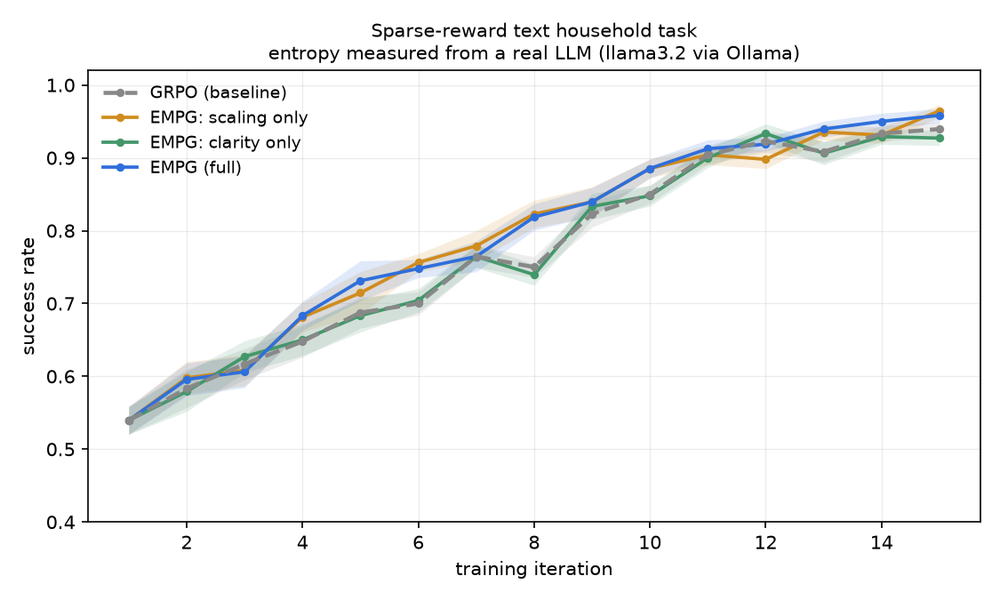
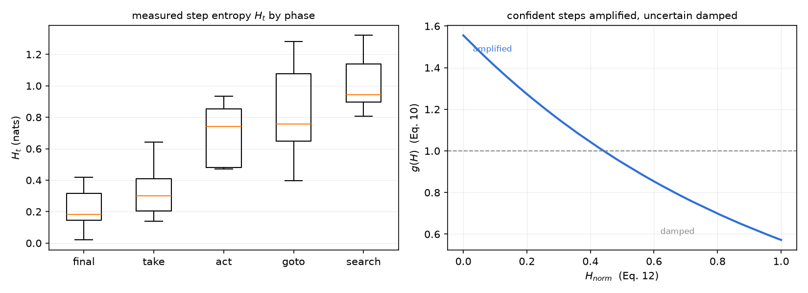

# Harnessing Uncertainty — an EMPG demo

A small, runnable demonstration of **Entropy-Modulated Policy Gradients (EMPG)**, from
[*Harnessing Uncertainty: Entropy-Modulated Policy Gradients for Long-Horizon LLM Agents*](https://arxiv.org/pdf/2509.09265)
(Wang et al., arXiv:2509.09265).

Step-level uncertainty is **measured from a real LLM** (llama3.2 served by Ollama, via its
token logprobs), and those measurements drive **real policy-gradient updates** on a small
PyTorch policy. Everything runs on CPU in seconds after a one-time warm-up of ~32 LLM calls.

---

## The problem, and what EMPG does about it

A long-horizon agent gets one sparse number at the end — did the task succeed? — and has to
work out which of its ten intermediate steps deserve the credit. Plain GRPO smears that single
scalar uniformly across every step.

Worse, as the paper observes, the *magnitude* of a policy gradient is naturally coupled to the
policy's entropy: confident steps produce small updates and uncertain ones produce large,
destabilising updates. That is backwards from what you want.

EMPG re-weights each step using its measured uncertainty (all equation numbers are the paper's):

```
H_norm      = (H - min H) / (max H - min H + eps)            (Eq. 12)
g(H_t)      = exp(-k*H_norm) / mean_batch[exp(-k*H_norm)]    (Eq. 10)   mean is exactly 1
f(H_t+1)    = exp(-k'*H_norm,t+1)                            (Eq. 11)
A_mod(i,t)  = A_i * g(H_t) + zeta * f(H_t+1)                 (Eq. 8)
A_final     = A_mod - mean_batch[A_mod]                       (Eq. 13)
```

`g` multiplies, so it scales magnitude and *preserves sign*. All three behaviours from the
abstract fall out of that one term:

| step | entropy | `g` | effect on the update |
|---|---|---|---|
| confident **and correct** (`A>0`) | low | `>1` | **amplified** |
| confident **but wrong** (`A<0`) | low | `>1` | **penalised harder** — "hallucinated confidence" |
| uncertain (either sign) | high | `<1` | **damped** |

`f` is the *future-clarity bonus*: it rewards actions that lead somewhere the agent feels sure
about, and being additive it still provides signal when every rollout in a group scores the
same and `A_i` collapses to zero.

---

## Quick start

```bash
python -m venv venv && venv/Scripts/activate      # Windows; use bin/activate elsewhere
pip install -r requirements.txt

ollama serve            # in another terminal
ollama pull llama3.2

python -m pytest tests/ -v      # 16 tests, no LLM needed
python inspect_entropy.py       # see the mechanism step by step
python run_demo.py --seeds 5 --ablation
```

---

## What you actually see

### 1. Entropy really does separate confident steps from ambiguous ones

This is not assumed — it is measured. Mean step entropy by task phase:

| phase | mean H (nats) | what it is |
|---|---|---|
| `final` | **0.11** | the last, obvious move |
| `take`  | 0.33 | picking up the object you just found |
| `act`   | 0.85 | clean / heat the object |
| `search`| 0.90 | *which of 3-4 identical containers?* |
| `goto`  | 1.07 | which location first? |

The genuinely ambiguous steps carry ~10x the entropy of the obvious ones. That spread is the
raw material EMPG works with; without it, `g(H)` would have nothing to modulate.

### 2. Confident errors get punished harder

From `inspect_entropy.py`, one real step — `drop mug` chosen at the *final* phase with
H=0.018, i.e. near-total confidence, and wrong:

```
traj st phase   ok    H_t  Hnorm   g(H)  f(H+1)  A_GRPO  A_EMPG  action
  5   6 final   n   0.018  0.000  1.709   0.902  -0.606  -1.122  drop mug   <- confident: amplified
```

GRPO gives it `-0.606`, the same as every other step in that failed episode. EMPG nearly
doubles the penalty to `-1.122`. Aggregated over a group:

```
mean A_EMPG, confident + failed = -0.969
mean A_EMPG, uncertain + failed = -0.452
```

### 3. When GRPO has no signal at all, EMPG still does

Whenever every rollout in a group shares an outcome — all fail, or all succeed — Eq. 4 gives
`A_i = 0` for *every step of every trajectory*, and GRPO's update is identically zero. EMPG's
advantages stay non-zero, because the additive clarity bonus still ranks the steps.

`inspect_entropy.py --task heat_food --group 3 --warmup 0` lands on this case (an untrained
head rarely finishes a task, so small groups often fail unanimously); the script detects it
and says so.

### 4. Training: EMPG ends slightly ahead



20 seeds, 15 iterations, group size 8, on three sparse-reward tasks. Because seed variance
dominates, the meaningful comparison is **paired** — same seed, both arms:

| method | final success | vs GRPO (paired) | t | seeds won |
|---|---|---|---|---|
| GRPO (baseline) | 92.7% ± 0.8% | — | — | — |
| EMPG: scaling only (`g`) | 94.4% ± 0.5% | **+1.7%** | +2.07 | 13/20 |
| EMPG: clarity only (`f`) | 92.1% ± 0.8% | −0.6% | −1.16 | 3/20 |
| **EMPG (full)** | **94.9% ± 0.6%** | **+2.2%** | **+3.05** | **14/20** |

Full EMPG beats GRPO consistently enough to be believable (t≈3). **The ablation does not match
the paper**, though: there, the clarity bonus alone was the stronger of the two mechanisms
(+2.2 vs +0.7 for scaling). Here it is the reverse — `g` carries essentially all of the
benefit and `f` alone is slightly *negative*. Two plausible reasons: episodes here are 5-10
steps rather than the paper's much longer horizons, so there is little future to be clear
about; and `zeta = 0.05` is tuned for their reward scale, not this one.



---

## How honest is this?

Deliberately so. Some things to keep in mind before reading anything into the numbers:

- **The gap is small.** +2.2 points paired over 20 seeds (t≈3.05, 14/20 seeds won) is a real
  effect on this task, but it is a demonstration of a mechanism — **not** a reproduction of the
  paper's +8.1-point ALFWorld result on a 1.5B model.
- **The ablation disagrees with the paper** (see above): here the gradient scaling does the
  work and the clarity bonus alone slightly hurts, which is the opposite of their Table 2.
- **Single-run numbers are unstable.** A 5-seed run of the same code put clarity-only at +2.8%
  on one occasion and +0.3% on another. Anything below ~20 seeds here is noise; if you re-run
  with `--seeds 5` expect the ablation ordering to move around.
- **Greedy evaluation saturates at 100%** for every arm, so it does not discriminate; the
  table above reports training success, which does.
- **EMPG is a training method, and Ollama cannot backpropagate.** So the frozen LLM supplies
  the *uncertainty*, and a small trainable head supplies the *policy*. The entropies and the
  gradients are both real; the trained parameter set is just far smaller than the paper's.
- **The environment is hand-written**, not real ALFWorld, and its ambiguous steps are
  ambiguous by construction.

## Design notes worth knowing

**Entropy is measured over the choice, not over prose.** The first implementation asked the
LLM for a free-text action and averaged token entropies. That signal was dominated by phrasing
noise — the 100%-accurate `take` step scored the *highest* entropy of any phase. Presenting
the actions as a labelled multiple choice and reading the distribution over the single label
token fixed it, and entropy started tracking competence as EMPG assumes.

**Ollama exposes logprobs only on the OpenAI-compatible route.** `/api/generate` rejects an
integer `logprobs` field; use `/v1/chat/completions` with `logprobs: true, top_logprobs: 20`.
The top 20 carry ~99.6% of the mass here, so renormalising over them is a sound entropy
estimate — and EMPG only ever uses entropy comparatively anyway (Eq. 12).

**Caching is a correctness feature, not just a speed one.** The LLM is frozen, so its
distribution over a given state is fixed; the environment has only ~32 reachable states. Every
arm therefore trains on *identical* entropies, and any difference between arms comes from the
advantage weighting rather than from resampling noise. A full 5-seed ablation makes **zero**
LLM calls once the cache is warm.

**The warm start is calibrated on purpose.** Too weak and the agent never finishes a task, so
every group scores 0 and `A_i = 0`; too strong and every rollout succeeds, so `A_i = 0` again.
Either extreme silently destroys the comparison. Training starts near 55% here, leaving both
in-group variance and headroom.

## Layout

```
empg/empg.py     Eq. 4, 8, 10-13 as pure functions - the paper, transcribed
empg/llm.py      Ollama client; step entropy from token logprobs (Eq. 7)
empg/env.py      sparse-reward ALFWorld-style text household tasks
empg/agent.py    LLM scores the options, small torch head picks
empg/train.py    shared loop; one flag switches GRPO <-> EMPG
run_demo.py      trains both arms, writes plots + results.json
inspect_entropy.py   per-step table of H, g, f and both advantages
tests/           16 unit tests pinning the abstract's claims
```
